# Database ER diagram

Generated directly from database/schema.prisma. Every model and declared foreign-key relation is included. SQL migrations add check constraints and immutable-ledger triggers.

```mermaid
erDiagram
  User {
    String id PK
    String email UK
    String name
    String passwordHash
    Role role
    Boolean active
    DateTime createdAt
  }
  RefreshToken {
    String id PK
    String userId FK
    String tokenHash UK
    String family
    DateTime expiresAt
    DateTime revokedAt
    DateTime createdAt
  }
  Seller {
    String id PK
    String userId FK
    String name
    String status
    Int commissionBps
    DateTime createdAt
  }
  Category {
    String id PK
    String name UK
    String slug UK
  }
  Product {
    String id PK
    String sellerId FK
    String categoryId FK
    String name
    String slug UK
    String description
    String image
    String status
    Boolean featured
    DateTime createdAt
    DateTime updatedAt
  }
  Variant {
    String id PK
    String productId FK
    String sku UK
    String name
    Int price
    Json attributes
  }
  Warehouse {
    String id PK
    String name UK
    String city
  }
  Inventory {
    String id PK
    String variantId FK
    String warehouseId FK
    Int onHand
    Int reserved
    Int threshold
  }
  StockMovement {
    String id PK
    String inventoryId FK
    String key UK
    String kind
    Int deltaOnHand
    Int deltaReserved
    String reason
    DateTime createdAt
  }
  Cart {
    String id PK
    String userId FK
    DateTime updatedAt
  }
  CartItem {
    String id PK
    String cartId FK
    String variantId FK
    Int quantity
  }
  Address {
    String id PK
    String userId FK
    String name
    String line1
    String city
    String region
    String postalCode
    String country
  }
  Order {
    String id PK
    String userId FK
    String checkoutKey
    String status
    Int subtotal
    Int discount
    Int shipping
    Int total
    String currency
    Json address
    DateTime expiresAt
    DateTime createdAt
    DateTime updatedAt
  }
  OrderItem {
    String id PK
    String orderId FK
    String variantId FK
    String sellerId FK
    String name
    Int quantity
    Int fulfilled
    Int unitPrice
    Int discount
    Int commission
  }
  Reservation {
    String id PK
    String orderId FK
    String inventoryId FK
    Int quantity
    String status
    DateTime expiresAt
  }
  Promotion {
    String id PK
    String code UK
    Int discountBps
    Int minSubtotal
    Int maxDiscount
    Boolean active
    DateTime endsAt
  }
  PromotionUse {
    String id PK
    String promotionId FK
    String userId FK
    String orderId FK
  }
  Payment {
    String id PK
    String orderId FK
    String provider
    String providerRef UK
    String status
    Int amount
  }
  PaymentEvent {
    String id PK
    String paymentId FK
    String type
    DateTime createdAt
  }
  Shipment {
    String id PK
    String orderId FK
    String warehouseId FK
    String key UK
    String providerRef UK
    String status
    DateTime createdAt
  }
  ShipmentItem {
    String id PK
    String shipmentId FK
    String orderItemId FK
    Int quantity
  }
  ShippingEvent {
    String id PK
    String shipmentId FK
    String status
    DateTime createdAt
  }
  ReturnRequest {
    String id PK
    String orderId FK
    String reason
    String status
    DateTime createdAt
  }
  ReturnItem {
    String id PK
    String returnId FK
    String orderItemId FK
    Int quantity
  }
  Refund {
    String id PK
    String returnId FK
    String paymentId FK
    String providerRef UK
    Int amount
    String status
    DateTime createdAt
  }
  FinancialMovement {
    String id PK
    String sellerId FK
    String orderItemId FK
    String refundId FK
    Int amount
    Int commission
    String kind
    DateTime createdAt
  }
  RefundEvent {
    String id PK
    String refundId FK
    DateTime createdAt
  }
  Review {
    String id PK
    String userId FK
    String productId FK
    Int rating
    String comment
    DateTime createdAt
  }
  Settlement {
    String id PK
    String sellerId FK
    String key UK
    Int amount
    String status
    DateTime createdAt
  }
  SettlementItem {
    String id PK
    String settlementId FK
    String orderItemId FK
    Int amount
  }
  Ticket {
    String id PK
    String userId FK
    String assigneeId FK
    String orderId FK
    String subject
    String message
    String status
    DateTime createdAt
  }
  TicketMessage {
    String id PK
    String ticketId FK
    String authorId
    String text
    DateTime createdAt
  }
  Dispute {
    String id PK
    String ticketId FK
    String returnId FK
    String status
    String resolution
    DateTime createdAt
  }
  AuditLog {
    String id PK
    String userId FK
    String action
    String resourceId
    Json details
    DateTime createdAt
  }
  BrowseEvent {
    String id PK
    String userId FK
    String productId FK
    String type
    DateTime createdAt
  }
  Outbox {
    String id PK
    String key UK
    String type
    Json payload
    DateTime processedAt
    DateTime createdAt
  }
  User ||--o{ RefreshToken : user
  User ||--o{ Seller : user
  Seller ||--o{ Product : seller
  Category ||--o{ Product : category
  Product ||--o{ Variant : product
  Variant ||--o{ Inventory : variant
  Warehouse ||--o{ Inventory : warehouse
  Inventory ||--o{ StockMovement : inventory
  User ||--o{ Cart : user
  Cart ||--o{ CartItem : cart
  Variant ||--o{ CartItem : variant
  User ||--o{ Address : user
  User ||--o{ Order : user
  Order ||--o{ OrderItem : order
  Variant ||--o{ OrderItem : variant
  Seller ||--o{ OrderItem : seller
  Order ||--o{ Reservation : order
  Inventory ||--o{ Reservation : inventory
  Promotion ||--o{ PromotionUse : promotion
  User ||--o{ PromotionUse : user
  Order ||--o{ PromotionUse : order
  Order ||--o{ Payment : order
  Payment ||--o{ PaymentEvent : payment
  Order ||--o{ Shipment : order
  Warehouse ||--o{ Shipment : warehouse
  Shipment ||--o{ ShipmentItem : shipment
  OrderItem ||--o{ ShipmentItem : orderItem
  Shipment ||--o{ ShippingEvent : shipment
  Order ||--o{ ReturnRequest : order
  ReturnRequest ||--o{ ReturnItem : returnRequest
  OrderItem ||--o{ ReturnItem : orderItem
  ReturnRequest ||--o{ Refund : returnRequest
  Payment ||--o{ Refund : payment
  Seller ||--o{ FinancialMovement : seller
  OrderItem ||--o{ FinancialMovement : orderItem
  Refund ||--o{ FinancialMovement : refund
  Refund ||--o{ RefundEvent : refund
  User ||--o{ Review : user
  Product ||--o{ Review : product
  Seller ||--o{ Settlement : seller
  Settlement ||--o{ SettlementItem : settlement
  OrderItem ||--o{ SettlementItem : orderItem
  User ||--o{ Ticket : user
  User ||--o{ Ticket : assignee
  Order ||--o{ Ticket : order
  Ticket ||--o{ TicketMessage : ticket
  Ticket ||--o{ Dispute : ticket
  ReturnRequest ||--o{ Dispute : returnRequest
  User ||--o{ AuditLog : user
  User ||--o{ BrowseEvent : user
  Product ||--o{ BrowseEvent : product
```

