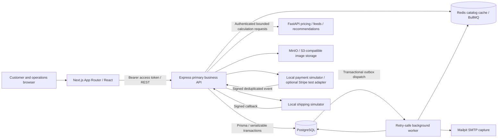

# Architecture and ownership



Express owns every authoritative record, all authorization decisions, and all state transitions. PostgreSQL is the only business system of record. FastAPI is stateless and receives bounded synthetic input from Express using a separate internal token. It never writes commerce records. Redis holds short-lived versioned catalog caches and job delivery state; stock correctness does not depend on a Redis lock. MinIO holds only sanitized public product assets. Mailpit captures local messages without external delivery. Local payment, shipping, and settlements are explicitly simulated.

The frontend uses one App Router catch-all route with modular customer, storefront, and operations components. TanStack Query manages remote state, React Hook Form and Zod validate sign-in fields, and backend Zod schemas validate all writes. Client route guards improve navigation only; the Express middleware and service ownership checks enforce access.

```mermaid
sequenceDiagram
  participant UI as Customer browser
  participant API as Express
  participant PY as FastAPI
  participant DB as PostgreSQL
  participant W as Worker
  UI->>API: POST checkout + access token + Idempotency-Key
  API->>PY: Quote authoritative cart snapshot (integer paise)
  PY-->>API: Exact line discounts and commissions
  API->>DB: SERIALIZABLE transaction; revalidate snapshot
  API->>DB: Conditional inventory increment; reservation + immutable ledger
  API->>DB: Create order, payment placeholder, coupon claim, outbox
  DB-->>API: Commit or retry serialization conflict
  API-->>UI: Order snapshot / meaningful stock conflict
  UI->>API: Confirm local sandbox payment
  API->>DB: Lock order, deduplicate event, consume reserved stock once
  DB-->>API: PAID + committed outbox
  W->>DB: Dispatch committed outbox and sweep expired unpaid orders
  API-->>UI: Confirmed order
```

`database/schema.prisma` and ordered SQL migrations are the schema authorities. The generated ER diagram in `database-er.md` includes every actual model and relation. Important boundaries: users and roles; seller ownership; category/product/SKU; per-warehouse stock; immutable stock and financial movements; order line price/commission snapshots; unique provider events; bounded returns and refund records; settlement line uniqueness; tickets, disputes, audit history, and the outbox.

Search uses PostgreSQL trigram indexes, paginated results, stable ordering, and a SQL aggregate for price sorting across the full filtered collection. Cache keys include the database name, catalog version, and normalized query. Stock/catalog writes invalidate the version; a 15-second TTL bounds cached display data after a cache outage. Checkout always reads and updates PostgreSQL directly.

Trade-offs: no Elasticsearch, distributed recommendation model, real payout network, taxation engine, or real carrier is needed for this synthetic assessment. Gross sales charts use UTC date buckets; user-facing timestamps use the browser locale. Local demo credentials are public synthetic credentials and must never be seeded into a public deployment. Full external integration and hosting verification need owner-provided sandbox accounts and a deployment target.
